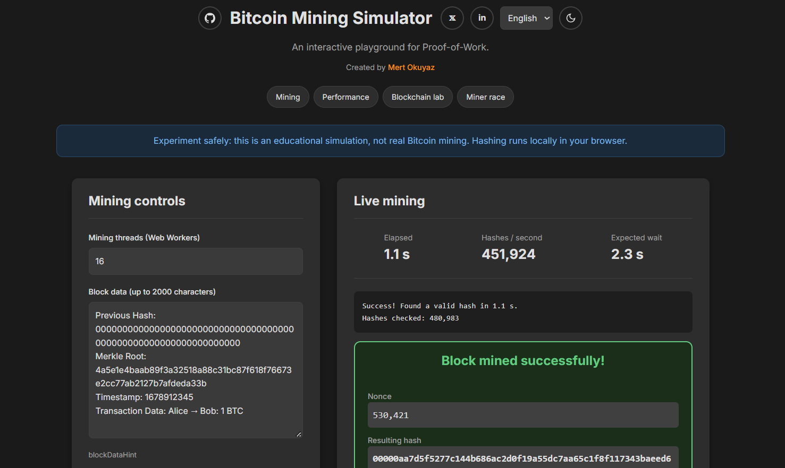

# Bitcoin Mining Simulator

An interactive, browser-based tool designed to visually and interactively explain the fundamental concept of Bitcoin mining and Proof-of-Work. This simulator allows users to see the "guess and check" process of finding a valid hash in real-time, experiment with blockchain tampering, race virtual miners, and compare mining performance right in their browser.

This project was created and conceptualized by [Mert Okuyaz](https://x.com/mertokuyaz_).

Live Demo
[mertokuyaz.github.io](https://mertokuyaz.github.io)



## Features

-   **Interactive Mining:** Start and stop the mining process with a single button. Choose between 1 and 16 Web Worker threads to explore parallel hashing.
-   **Adjustable Difficulty:** Choose from multiple difficulty levels (number of leading hexadecimal zeros), including a quick-demo setting, to see how difficulty affects the time required to find a hash.
-   **Real-time Statistics:** Get live feedback on key metrics:
    -   **Time Spent:** Total duration of the current mining attempt.
    -   **Hashes/sec:** The measured speed at which your browser is performing SHA-256 hashing operations.
    -   **Expected Wait:** A statistical estimate based on the current hash rate and difficulty, not a countdown or a guaranteed completion time.
-   **Live Process Log:** See the mining process unfold with a log that shows hashes checked, the latest nonce, and the resulting hash.
-   **Blockchain Tampering Lab:** Create three linked demo blocks or mine your own chain. Edit an earlier block to see its hash change, broken links, and invalid descendants. Repair the affected chain by re-mining blocks in order, or stop an ongoing repair while keeping completed work.
-   **Miner Race:** Adjust the relative hash power of three virtual miners and run a 30-round probability simulation. Compare expected win probabilities with observed results to see why more power improves the odds without guaranteeing a win.
-   **Live Performance Chart:** Compare the last five mining runs using colored hash-rate curves and an accessible summary table showing thread counts, difficulty, average and peak sampled speed, elapsed time, and completion status.
-   **English & Turkish:** Switch the interface, educational content, chart labels, and status messages between English and Turkish, even during an active experiment. Your language preference is saved locally when available.
-   **Light & Dark Themes:** Switch themes manually or follow your system preference. Successful mining includes a short sound and confetti that respects reduced-motion preferences.
-   **Secure & Local:** Uses the browser's built-in [Web Crypto API](https://developer.mozilla.org/en-US/docs/Web/API/Web_Crypto_API) for hashing. Mining data stays in your browser; the optional Inter font is loaded from Google Fonts.
-   **Educational Sections:** Includes clear, concise explanations of SHA-256, Proof-of-Work, blockchain links, mining probability, and how the simulator differs from real Bitcoin.
-   **Fully Responsive:** The layout works on desktop and mobile devices, with keyboard-accessible controls, descriptive labels, and textual explanations of invalid blocks.

## How It Works

This simulator does not mine real Bitcoin or earn coins. It demonstrates the core logic of Proof-of-Work using simplified block data and difficulty rules.

### The Mining Process (Proof-of-Work)

1.  **Data:** A Bitcoin miner bundles a version, the previous block's hash, a Merkle root summarizing transactions, a timestamp, a difficulty target encoding, and a nonce into a block header.
2.  **Nonce:** The miner changes the `nonce` (number used once) to try different candidate headers.
3.  **Hashing:** Bitcoin applies **double SHA-256** to its fixed 80-byte block header. This simulator uses a single SHA-256 on a simplified representation of the previous hash, editable data, and nonce.
4.  **Checking:** The miner checks whether the hash is below the difficulty target. In this simulator, that is simplified to requiring leading hexadecimal zeros (e.g., `00000...`). Each extra zero makes success 16 times less likely per attempt.
5.  **Iteration:** If the hash does not meet the target, the miner changes the nonce and tries again. More hash power means more attempts, not a guaranteed win.

The first Bitcoin miner to find a valid block can broadcast it to the network and claim the block reward and transaction fees, subject to the network's validation and consensus rules.

### The Simulator's Role

The **Block data** textarea starts with an editable example containing `Previous Hash`, `Merkle Root`, `Timestamp`, and `Transaction Data`. These fields are example text, including an illustrative Merkle root; they are not parsed as a real Bitcoin header. The simulator adds the actual previous block hash separately when mining, preserving the linked-chain experiment.

The JavaScript code in `script.js`, `worker.js`, and `core.js` automates this process:

-   When you click **"Start mining"**, it reads the `Block data` textarea and includes the preceding block's hash. The first block references 64 zero characters.
-   It starts the selected number of Web Workers, each searching a separate nonce sequence so they do not duplicate work.
-   Each worker uses the **Web Crypto API** to calculate:
    ```text
    SHA256(JSON.stringify([previousHash, data]) + nonce)
    ```
-   It checks whether the hash starts with the required number of zeros based on the selected **Difficulty**.
-   If a valid hash is found, the workers stop, the winning `nonce` and `hash` are displayed, and the block is added to the mini-blockchain.
-   Otherwise, the workers keep searching and report progress for the live statistics and performance chart. Reported counts include the successful partial batch, but not in-flight work on terminated workers.
-   Expected wait is calculated as `16 ** difficulty / measuredHashRate`. Each attempt is independent, so past failures do not reduce the remaining expected wait.

### The Interactive Experiments

-   **Change a Block:** Click **"Create 3 demo blocks"**, then edit an earlier block's data. Its hash is recalculated, so the next block's stored previous hash no longer matches. Descendants are invalid even when their own hashes still meet their targets. Click **"Repair invalid chain"** to update links and re-mine the affected blocks in order. Demo blocks use 2 leading zeros for fast experiments; at this easy target, an edited block can occasionally still satisfy its own proof by chance.
-   **Race Miners:** Set relative powers such as 10, 30, and 60. The expected winning chances are 10%, 30%, and 60%, but any miner can win a round. Each miner receives an independent exponential random waiting time proportional to its power; the first wins. Bars show observed win shares, not deterministic progress toward a hash. Changing powers resets the results for a fair comparison.
-   **Compare Performance:** Mine with different thread counts and compare the last five runs in **"Live performance"**. Keep the difficulty consistent when comparing. Device load, worker startup, and browser scheduling affect results; more threads do not always mean more speed. Stopping mining preserves its curve and summary.
-   **Switch Languages:** Select **English** or **Türkçe** in the header. Controls, educational explanations, and live messages update without clearing the experiment. Theme and language preferences are saved locally; chains, performance history, and race results reset when the page reloads.

The race is a mathematical simulation, not a hardware benchmark. The local chain does not simulate Bitcoin's network consensus or accumulated-work competition.

## Tech Stack

-   **HTML5:** For the structure, semantic sections, accessible controls, and performance summary table.
-   **CSS3:** For styling, light/dark themes, responsive layouts (Flexbox & Grid), and reduced-motion support.
-   **Modern JavaScript (ES6+):** For application logic, DOM manipulation, English/Turkish translations, chain validation, and the race probability model.
-   **Web Crypto API:** For the SHA-256 hashing used in mining and block validation.
-   **Web Workers:** For parallel nonce searches without blocking the interface.
-   **Canvas API:** For the live performance chart and mining-success confetti, without third-party JavaScript libraries.
-   **Node.js Test Runner:** For dependency-free automated tests covering hashing, tampering and repair, race probabilities, worker accounting, and translation consistency.

## Getting Started

To run this project on your local machine, follow these steps. No build step or JavaScript package installation is required.

### Prerequisites

You need a modern web browser that supports Web Crypto, Web Workers, Canvas, and ResizeObserver (Chrome, Firefox, Safari, Edge, etc.). Python 3 or another static web server is needed to serve the files locally. Node.js 22 or newer is only required if you want to run the automated tests.

### Installation

1.  Clone the repository to your local machine:
    ```sh
    git clone https://github.com/mertokuyaz/mertokuyaz.github.io.git
    ```
2.  Navigate into the project directory:
    ```sh
    cd mertokuyaz.github.io
    ```
3.  Run a local web server in that directory.

    **Important:** The Web Crypto API (`crypto.subtle`) requires a secure context. Serve the files over `https://` or `localhost` rather than opening `index.html` directly from your file system.

    You can use Visual Studio Code's **[Live Server](https://marketplace.visualstudio.com/items?itemName=ritwickdey.LiveServer)** extension.

    Alternatively, with Python 3:
    ```sh
    python -m http.server 8000 --bind 127.0.0.1
    ```
    Then open [http://127.0.0.1:8000](http://127.0.0.1:8000).

### Running Tests

With Node.js 22 or newer, run:

```sh
npm test
```

No `npm install` is needed. On Windows, if PowerShell blocks `npm.ps1`, use `npm.cmd test` instead.

The automated tests cover known SHA-256 output, valid chains, tampering and ordered repair, invalid descendants, genesis links, waiting-time calculations, weighted race probabilities, worker hash counts, and matching English/Turkish translation keys.

## License

This project is licensed under the MIT License.
